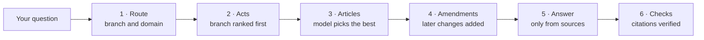

  

  
  
  
  

  <b>English</b> · <a href="README.ro.md">Română</a>
  &nbsp;|&nbsp;
  <a href="#quick-start">Quick start</a> ·
  <a href="#how-it-works">How it works</a> ·
  <a href="#limitations">Limitations</a> ·
  <a href="#troubleshooting">Troubleshooting</a> ·
  <a href="docs/ARCHITECTURE.md">Architecture</a>

---

**Avocat AI Moldova** answers questions about the laws of the Republic of Moldova in plain language, with a Romanian interface. Every answer cites the articles it relies on and links to the official sources. The AI model, the legal index and your chat history all stay on your computer.

> [!WARNING]
> **This is not legal advice and it is not a lawyer.** Answers are generated automatically and can be wrong, incomplete or out of date. Always check the cited source, and consult a licensed lawyer for important decisions.

## Features

| | |
| --- | --- |
| 💬 **Chat with sources** | Answers cite specific articles, with links to the act in the app and on the official sites. |
| 🔎 **Search** | Full-text and title search across indexed acts, filtered by type, status, domain and year. Handles missing diacritics and references like `95/2021`. |
| 🌳 **Tree routing** | Each question is routed to a legal branch, whose acts rank first, so a customs question favours customs law while the rest of the legislation still competes. The route is shown as it happens. |
| 📅 **Status tracking** | Adoption and publication dates, detected repeals, the replacing act, and known future changes. |
| 🧠 **Model management** | Download, switch, delete or add any Ollama model or Hugging Face GGUF from the UI. Load or unload a model, or stop the AI engine entirely to free all of its memory. |
| ⚙️ **Background indexing** | Resumes after restarts and only fetches new issues. Failed issues retry automatically or from the **Probleme** page. |
| 🔒 **Private by design** | Questions and answers never leave your machine. The internet is only used to download legislation, models and the runtime. |

## Quick start

**Requirements:** Windows 10 or 11 (x64), at least 30 GB of free disk space, and an internet connection for the first run.

1. Download `AvocatAI.exe` from the [latest release](https://github.com/Akulav/ai-lawyer-moldova/releases/latest).
2. Put it in a folder of its own and run it.
3. Your browser opens at <http://127.0.0.1:18917> once the app is ready. If that port is taken, the app uses the next free one.

Nothing is installed system-wide: uv, Python, Ollama and the models all stay in that folder. You can check the download against `SHA256SUMS.txt` in the release.

### The tray icon

The app runs in the system tray, not in a console window.

| Action | Result |
| --- | --- |
| Left-click the icon | Opens the app in the browser. |
| Right-click → **Deschide folderul programului** | Opens the program folder. |
| Right-click → **Deschide jurnalul** | Opens the log. |
| Right-click → **Repornește** | Restarts the server. |
| Right-click → **Ieșire** | Stops the server and the AI engine, freeing the RAM and VRAM the model used. |

The AI engine also stops if the program is ended some other way, for example from Task Manager. Running the exe again while the app is running only opens the browser.

### Using it from other devices

To open the app from a phone, tablet or another computer on your LAN or VPN, turn on **Acces din rețeaua locală sau VPN** on the **Setări** page, then click **Repornește acum**. The page lists the addresses to open, such as `http://192.168.1.20:18917`. If Windows Firewall asks, allow access, or allow the port it shows. Turning the setting off refuses other devices at once.

> [!CAUTION]
> There is no login. Anyone who can reach that port can use the app and read its conversations, so only do this on networks you trust.

### Running from source

From a copy of this repository, `run.bat` starts the same app in a console window.

### What it downloads

| Component | Size |
| --- | --- |
| Ollama runtime | about 1.6 GB |
| Default model | 5.2 to 17.7 GB, depending on your RAM |
| Legal index (`data/lege.db`) | grows as it indexes; expect several GB |

| System RAM | Default model | Notes |
| --- | --- | --- |
| 32 GB or more | `qwen3.8:27b` (17.7 GB) | Most accurate in testing; took about 4.5 minutes per answer on a 16 GB GPU |
| 24 GB or more | `qwen3:14b` (9.3 GB) | About 1.5 minutes per answer, but made legal and arithmetic errors in testing |
| Less | `qwen3:8b` (5.2 GB) | For modest hardware; not evaluated for legal accuracy |

These timings come from a single test question on one machine (Radeon RX 9070 XT, Ryzen 9 9900X, 32 GB RAM), so treat them as a rough guide.

## How it works

A background crawler reads [Monitorul Oficial](https://monitorul.gov.md) issue by issue, splits each act into articles and stores them in a local SQLite full-text index. When you ask a question, a model running in a private Ollama instance on your computer walks the legal tree, picks the relevant articles and writes an answer that cites only those articles. The app then checks that every citation points to a real source. See [Architecture](docs/ARCHITECTURE.md) for the details.

## Limitations

Read these before relying on any answer.

- **Coverage is not complete.** The automatic source is Monitorul Oficial, with issues going back to about 2001. Older acts, such as the 1997 Fiscal Code, may appear as titles only until you import them.
- **Texts are not consolidated by default.** Indexed text is the version as originally published. Amendments are linked as separate acts, and the app warns you when a source is unconsolidated.
- **Status is detected automatically.** "Abrogat" is derived from the wording of other acts and can be wrong. "Fără abrogare detectată" does not guarantee an act is in force.
- **Models make mistakes.** The test answer got the customs thresholds right but still contained a wrong worked example. Citations are checked to exist, but the legal reasoning is not verified.

[`legis.md`](https://www.legis.md) has the consolidated versions but blocks automated access, and this project does not circumvent that. To add a consolidated text, open the act on `legis.md`, click **Pdf**, and drag the file into the Index page. See [Data sources](docs/DATA_SOURCES.md).

## Configuration

Optional environment variables, set before running `run.bat`:

| Variable | Default | Purpose |
| --- | --- | --- |
| `MAL_PORT` | `18917` | First port tried for the web UI |
| `MAL_OLLAMA_PORT` | `18971` | First port tried for the bundled Ollama |
| `MAL_DATA` | `data/` | Location of the database and models |

The app always runs its own Ollama instance on its own port and model folder, so it does not use or affect other Ollama installations.

## Troubleshooting

| Symptom | What to do |
| --- | --- |
| "Modelul AI nu este gata" | The model is still downloading. Check progress on the **Modele AI** page. Search works in the meantime. |
| The AI engine won't start | Check `.runtime/ollama.log`. |
| The app won't start from the exe | Right-click the tray icon → **Deschide jurnalul**, or open `.runtime/app.log`. |
| HTTP 504 lines in the log | Usually harmless. Each download gets 5 tries, and an issue only appears on the **Probleme** page if all of them fail. |
| Answers are slow | Choose a smaller model on the **Modele AI** page, accepting lower accuracy. |
| A code shows "Doar titlu" | Its issue isn't indexed yet or isn't available. Import the PDF from `legis.md` on the Index page. |

To reset the app, close it and delete `data/` (index, chat history, models) and `.runtime/` (downloaded components).

## Documentation

- [Architecture](docs/ARCHITECTURE.md): how a question is answered, how indexing works, and the database schema
- [Data sources](docs/DATA_SOURCES.md): where the data comes from, its limits, and how status is derived
- [Contributing](CONTRIBUTING.md): development setup, tests and project rules

## License

**Source-available, not open source.** You may run the releases and builds you make yourself, read the code, and modify it for your own use. You may share modified versions privately and free of charge with a small group of friends or family, and fork this repository to send changes back. You may not publish or redistribute the software or modified versions, or make money from it. See [LICENSE](LICENSE) for the full terms. Official legal texts remain subject to the terms of their sources.

 Avocat AI Moldova · made for the Republic of Moldova

