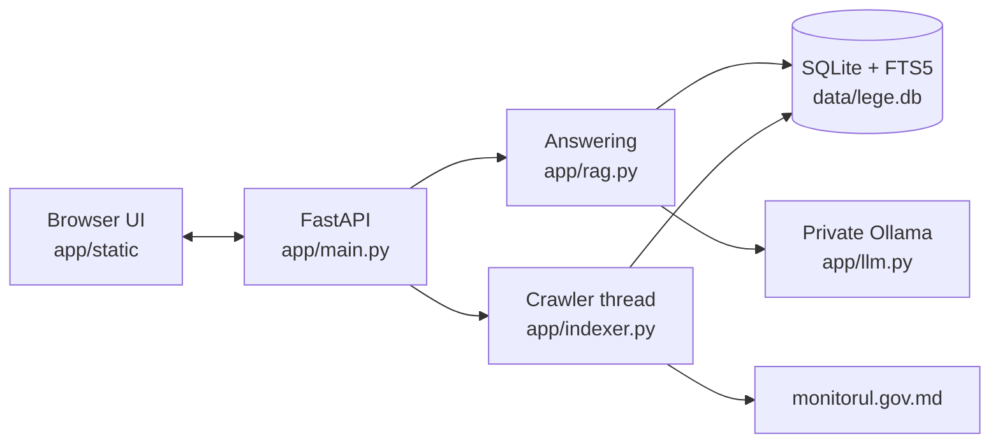

# Architecture

A single local Python process serves the API and UI, runs the indexer in a background thread, and supervises a private Ollama process.

## Modules

| File | Responsibility |
| --- | --- |
| `app/main.py` | HTTP API, static UI, port selection |
| `app/rag.py` | Tree traversal, retrieval, prompts, citation checks |
| `app/tree.py` | Legal taxonomy, key acts, domain classification |
| `app/indexer.py` | Crawler, storage, versions, status derivation, PDF import |
| `app/gazette.py` | Parsing gazette listings and PDFs, splitting issues into acts |
| `app/text.py` | Folding, stemming, act references, repeal and date detection, article splitting |
| `app/llm.py` | Portable Ollama lifecycle, model catalogue, inference |
| `app/tagger.py` | Background thread that files untagged acts into domains with the model |
| `app/verify.py` | Index health checks and their safe repairs |
| `app/sysinfo.py` | RAM and VRAM readings for the Index page |
| `app/db.py` | Schema and connections |
| `app/config.py` | Paths, ports, port availability, name and version |
| `app/static/` | The single-page UI: `index.html`, `app.js`, `style.css` |
| `launcher/` | Rust tray launcher that builds `AvocatAI.exe` |

## Answering a question

Each level narrows the search. Every step is streamed to the UI.

1. **Branch and domain.** The model picks at most two domains from the tree and suggests legal search terms. A JSON schema restricts its output to real domain IDs. If the call fails, `keyword_route` is the fallback.
2. **Acts.** All legislation is searched, and acts in those domains (plus laws amending their key acts) get a relevance bonus, so an act filed elsewhere can still win on merit. Repealed acts are excluded. If nothing in the branch matches, the UI says the search was widened.
3. **Articles.** BM25 ranks the chunks, with key acts boosted most and a per-act cap (larger for key acts). The model chooses up to 8 from a pool of 50.
4. **Amendments.** Because published texts aren't consolidated, `amendment_clauses` adds clauses from later laws that instruct a change to a chosen article.
5. **Answer.** The model writes only from these sources under fixed headings. Scheduled changes are listed separately from law in force.
6. **Checks.** The app warns about citations that match no source, answers with no citations, and unconsolidated sources. A question with no matching source gets a "not found" message and never reaches the model.

These checks confirm that citations exist. They do not verify the legal reasoning.

## Indexing

The crawler is a single thread, and its progress lives in the `issues` table, so restarts resume where they left off.

1. **Discover:** read the newest issue number from the homepage and add unseen numbers.
2. **Catalogue:** read each issue's act list. This is fast and yields titles, numbers and dates.
3. **Text:** download PDFs by priority (codes, then laws, then government decisions, newest first). Split them into acts and articles, store chunks, and extract relations.
4. **Status:** recompute repeals from stored relations, every 25 issues and at the end of a pass.
5. **Idle:** wait 6 hours and repeat. A manual retry ends the wait.

### Issue states

| Status | Meaning |
| --- | --- |
| `pending` | Number known, listing not read |
| `listed` | Catalogue read, waiting for text |
| `done` | Text processed |
| `missing` | The site returned 404; a normal gap in numbering |
| `no_text` | PDF unavailable or without extractable text, often a scan |
| `error` | All download tries failed; retried each cycle, up to 20 cycles |

Each request gets 5 tries with growing waits for 429 and 5xx responses and network errors. The crawler identifies itself in its User-Agent and pauses between requests.

## Data model

| Table | Contents |
| --- | --- |
| `issues` | Gazette issues and crawl state |
| `acts` | One row per act: type, number, dates, status, replacement, current version, links |
| `versions` | Texts of an act, with effective date, source and whether consolidated |
| `chunks`, `chunks_fts` | Article-level text with its Titlu › Capitol › Secțiune path, and the stemmed search index |
| `acts_fts` | Stemmed titles |
| `act_domain` | Act-to-domain assignments |
| `relations` | `modifica` and `abroga` links, stored by number and year because the target may not be indexed yet |
| `conversations`, `messages`, `settings` | Chat history and app settings |

**Current version:** the newest version in force today, with consolidated texts preferred. Versions with a future effective date are never treated as current law.

## Design rules

- **The engine ends with the app.** Closing the console window kills Python without running the shutdown hook. Ollama is therefore put in a Windows job object with KILL_ON_JOB_CLOSE, which also covers the model runners it starts later. The system ends the job when the app's process exits, however it exits.
- **Commit before anything slow.** SQLite allows one writer at a time, and other writers give up after 30 s. The crawler commits before every download and every pause.
- **Never touch another Ollama.** The app only talks to a process it started, from its own binary, on a port that nothing else answers on. Cleanup of leftover processes matches its own executable path only.
- **Check that a port is really free.** On Windows, binding `127.0.0.1` can succeed while another program listens on `0.0.0.0`, silently shadowing it. `port_is_free` tests both.
- **False repeals are the costly error.** A wrongly repealed act disappears from answers, so detection is strict. See [Data sources](DATA_SOURCES.md#how-status-is-derived).
- **Local access by default.** The server binds to `127.0.0.1` and has no authentication. The `lan_access` setting (Setări page) makes it bind to `0.0.0.0` at the next start, to serve other devices on a LAN or VPN; anyone who reaches the port can then read conversations, import documents and manage models, so use it only on trusted networks. Turning it off takes effect at once: a middleware refuses non-local clients until the restart closes the port. The setting, restart and quit can only be changed from `127.0.0.1`. Ollama always stays on `127.0.0.1`.
- **Restart by exit code.** `POST /api/restart` stops the server cleanly and exits with code 3; the tray launcher and `run.bat` start it again. A plain `python -m app.main` cannot restart itself, and the UI says so.

## API

| Method and path | Purpose |
| --- | --- |
| `GET /api/status`, `GET /api/identity` | App state; instance identity (the launcher checks `app`) |
| `POST /api/disclaimer` | Record that the disclaimer was accepted |
| `POST /api/quit`, `POST /api/restart` | Clean shutdown (the tray's **Ieșire**) or restart (exit code 3); only from 127.0.0.1 |
| `GET /api/settings`, `POST /api/settings/lan` | LAN access setting and where the server listens; changes only from 127.0.0.1 |
| `POST /api/chat` | Streaming answer (Server-Sent Events) |
| `GET`, `DELETE /api/conversations...` | Chat history |
| `GET /api/search`, `GET /api/acts/{id}`, `GET /api/tree` | Search and browsing |
| `POST /api/index/pause`, `POST /api/index/resume`, `POST /api/import` | Index control and PDF import |
| `GET /api/problems`, `POST /api/problems/{id}/retry`, `POST /api/problems/retry-all` | Failed issues |
| `GET /api/verify`, `POST /api/verify/repair` | Index health check and safe repairs |
| `POST /api/tagger/pause`, `POST /api/tagger/resume` | Background domain tagging |
| `GET /api/models`, `POST /api/models/pull`, `/cancel`, `/active`, `/load`, `/unload`, `DELETE /api/models/{name}` | Model management |
| `POST /api/engine/stop`, `POST /api/engine/start` | Stop or start the private Ollama, freeing all AI memory |
